# Лабораторная работа №6. Масштабирование и балансировка нагрузки

**Elastic Load Balancing, Amazon EC2 Auto Scaling**

- Студент: Фулга Влада, группа IA2404
- Проект: TimeCapsule
- Регион: eu-central-1
- Уровень: базовый (Часть 1, задания 1-3)

---

## Цель работы

Научиться распределять запросы между серверами с помощью Application Load Balancer и поручать Amazon EC2 Auto Scaling добавлять и убирать серверы по нагрузке.

---

## Задание 1. Балансировщик

### 1.1. Security Group для балансировщика

Создана группа `lab6-alb-sg` в VPC из ЛР3. Входящее правило: HTTP (80) из любого места (0.0.0.0/0). Добавлен тег `Lab = lab6`.

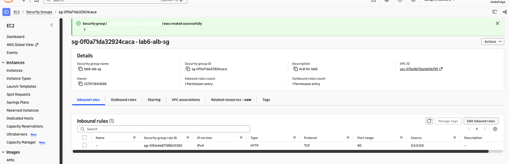

### 1.2. Security Group для серверов

Создана группа `lab6-web-sg`. Входящие правила: HTTP (80) только от `lab6-alb-sg`, SSH (22) только от Security Group бастиона. Серверы принимают HTTP только от балансировщика, а SSH только с bastion.

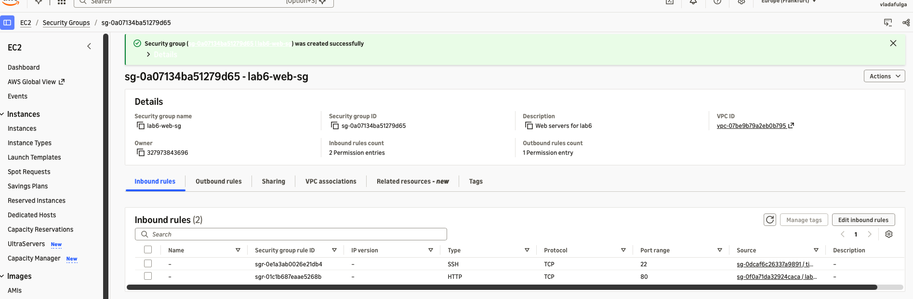

### 1.3. Целевая группа

Создана целевая группа `lab6-tg`: тип целей Instances, протокол HTTP, порт 80. Проверка работоспособности: путь `/health`, интервал 10 секунд.

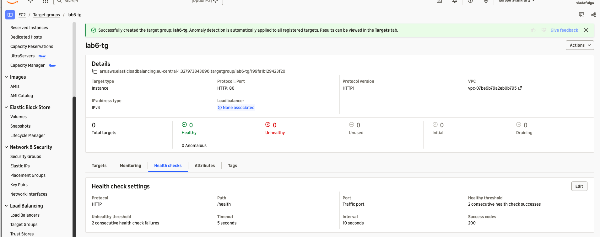

### 1.4. Application Load Balancer

Создан балансировщик `lab6-alb` (Internet-facing) в подсетях `public-a` и `public-b` с группой безопасности `lab6-alb-sg`. Добавлен listener HTTP:80, который передаёт запросы в `lab6-tg`.

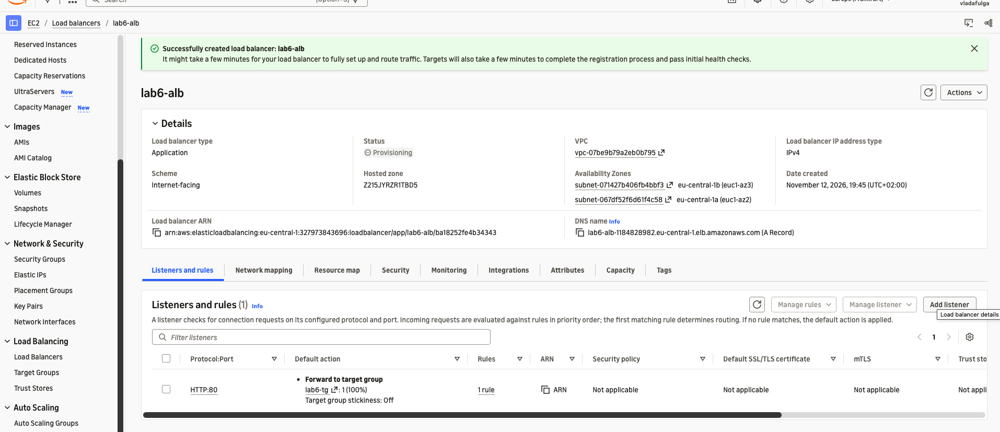

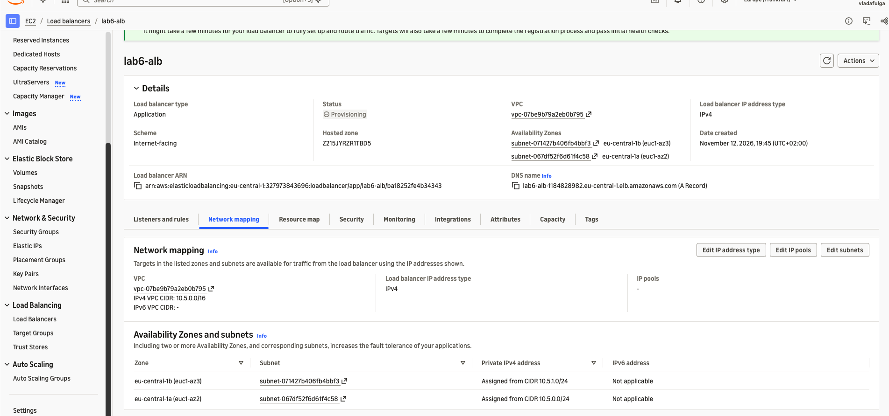

### 1.5. Обращение к балансировщику

В браузере открыт DNS name балансировщика.

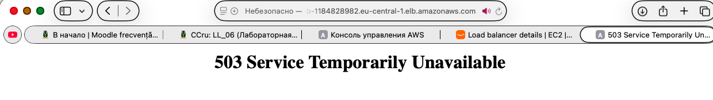

**Какой ответ вернул балансировщик и почему?**

Балансировщик вернул ошибку 503 Service Temporarily Unavailable. В целевой группе `lab6-tg` пока нет ни одного сервера, поэтому передавать запрос некому.

**Зачем ему подсети в двух зонах?**

Для отказоустойчивости. Если одна зона доступности выйдет из строя, балансировщик продолжит работать через вторую. Кроме того, ALB требует минимум две подсети в разных зонах.

---

## Задание 2. Группа Auto Scaling

### 2.1. Шаблон запуска

Создан шаблон `lab6-lt`: Amazon Linux 2023, тип `t3.micro`, ключ `vlada-keypair`. Подсеть в шаблоне не указана, её выбирает группа. Security Group сервера: `lab6-web-sg`, публичный IP включён. В User data вставлен скрипт, который устанавливает nginx и выводит на странице имя сервера и зону.

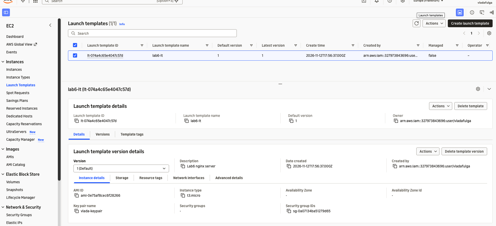

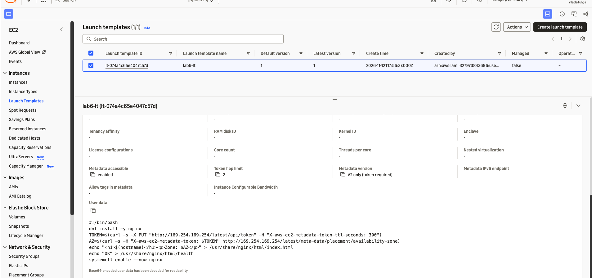

### 2.2. Группа Auto Scaling

Создана группа `lab6-asg` из шаблона `lab6-lt` в подсетях `public-a` и `public-b`. Серверы регистрируются в `lab6-tg`, включены проверки ELB. Размер группы: желаемое 2, минимум 2, максимум 4.

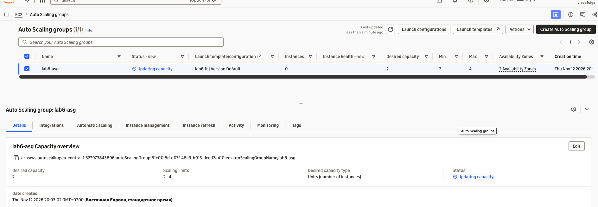

Добавлена политика target tracking `lab6-requests-policy` по метрике Application Load Balancer request count per target с целевым значением 50. Политика сама создаёт две тревоги CloudWatch: AlarmHigh (добавляет серверы) и AlarmLow (убирает лишние).

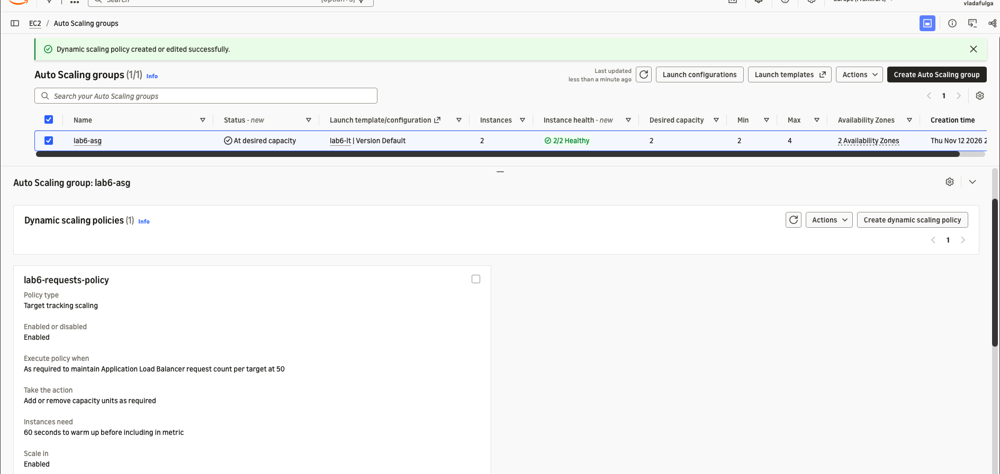

### 2.3. Проверка

Оба сервера в `lab6-tg` перешли в состояние healthy.

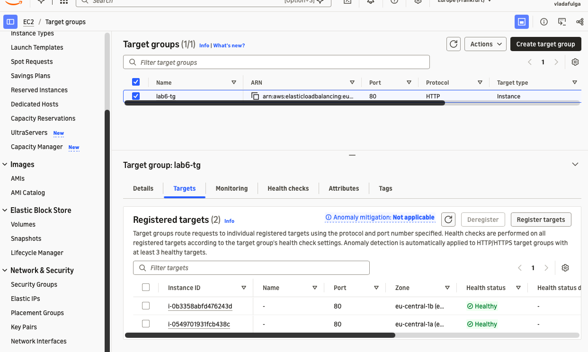

При обновлении страницы балансировщика отвечают разные серверы из разных зон.

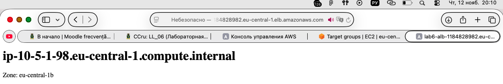
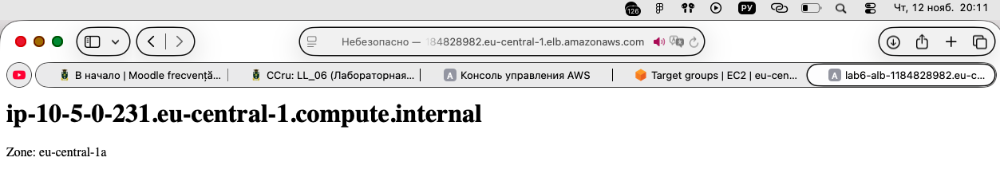

**Чем группа Auto Scaling отличается от целевой группы?**

Целевая группа - это список серверов, между которыми балансировщик распределяет запросы, плюс проверка их работоспособности. Группа Auto Scaling создаёт и удаляет сами серверы по шаблону запуска в зависимости от нагрузки и регистрирует их в целевой группе.

**Почему в шаблоне нет подсети?**

Подсеть выбирает группа Auto Scaling при запуске каждого сервера, чтобы равномерно распределять их по зонам. Подсеть привязана к одной зоне, поэтому если бы она была в шаблоне, все серверы запускались бы в одной зоне.

---

## Задание 3. Нагрузка

### 3.1. Запуск нагрузки

Нагрузка подавалась скриптом, который 10 минут подряд отправлял запросы на DNS-имя балансировщика.

### 3.2. Тревоги CloudWatch

Тревога `AlarmHigh` перешла в состояние ALARM.

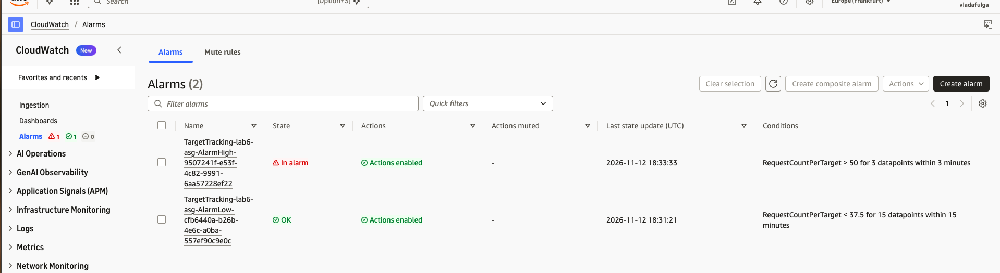

График метрики `RequestCountPerTarget` на странице тревоги:

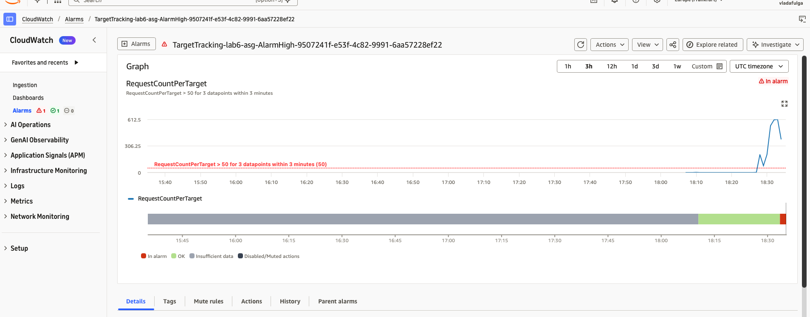

Вкладка History: время перехода в состояние ALARM.

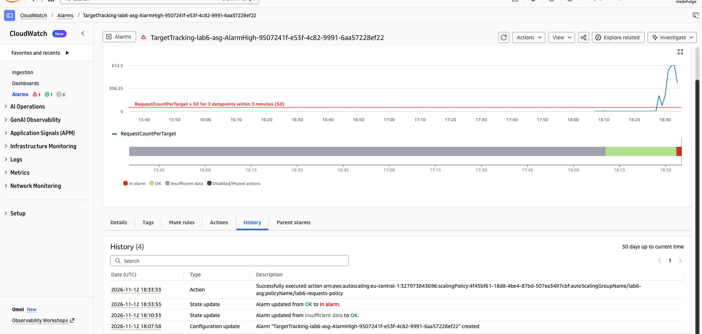

### 3.3. История группы

На вкладке Activity видно, что группа запустила новые серверы. В поле Cause указано, что причиной стала политика target tracking (сработала тревога AlarmHigh).

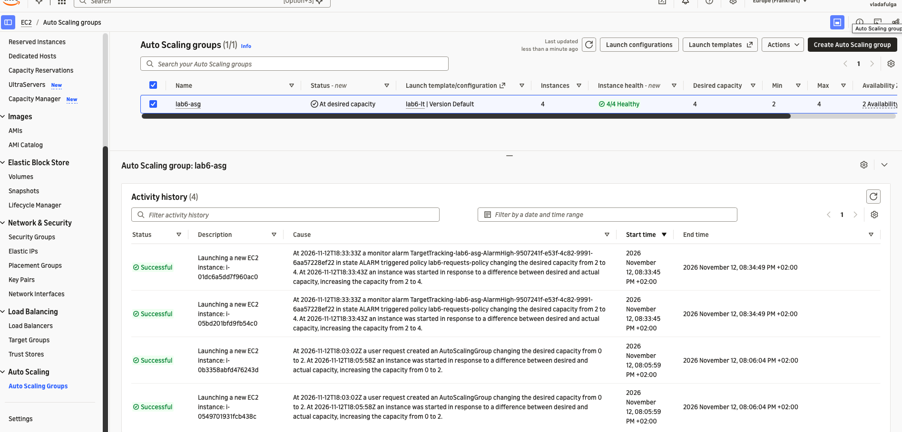

Состав группы под нагрузкой:

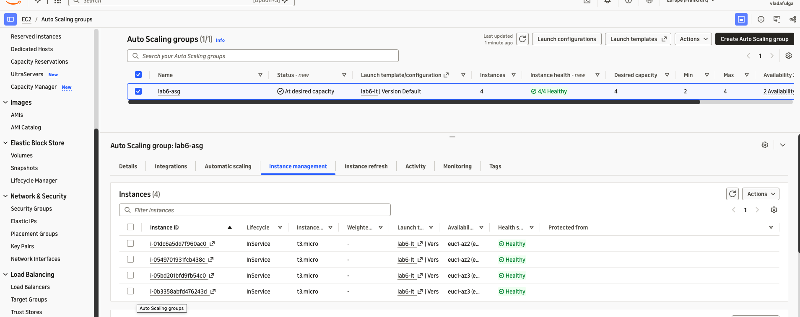

### 3.4. Возврат к двум серверам

После окончания нагрузки группа завершила лишние серверы и вернулась к двум.

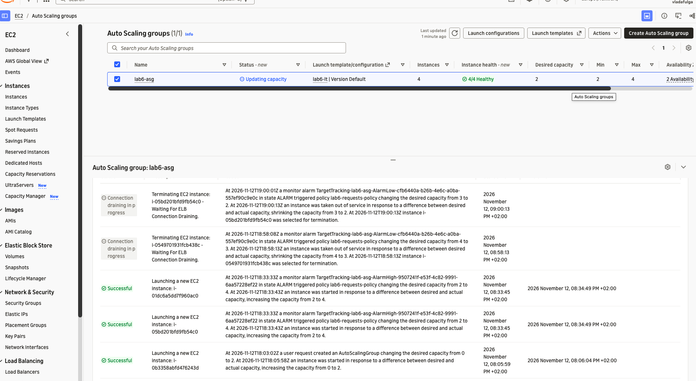

**Сколько серверов запустила группа и почему не больше четырёх?**

Группа запустила 4 сервера. Больше четырёх она запустить не может, потому что максимальный размер группы задан равным 4.

**Почему метрика упала после запуска новых серверов, хотя запросов не стало меньше?**

Метрика `RequestCountPerTarget` - это число запросов на один сервер, то есть общее число запросов, делённое на число серверов. Общий поток остался прежним, но делится на большее число серверов, поэтому значение на каждый сервер уменьшилось.

**Почему группа добавляет серверы быстрее, чем убирает?**

При росте нагрузки важно быстро добавить серверы, чтобы пользователи не получали задержки и ошибки. Убирать серверы группа начинает осторожно: тревога AlarmLow срабатывает только после длительного периода низкой нагрузки (около 15 минут). Так группа не удаляет сервер, который через минуту снова понадобится, и не «дёргается» при коротких колебаниях.

---

## Завершение Части 1. Удаление ресурсов

Удалены в таком порядке: группа `lab6-asg` (серверы удалились вместе с ней), балансировщик `lab6-alb`, целевая группа `lab6-tg`, шаблон `lab6-lt`, Security Groups `lab6-web-sg` и `lab6-alb-sg`.

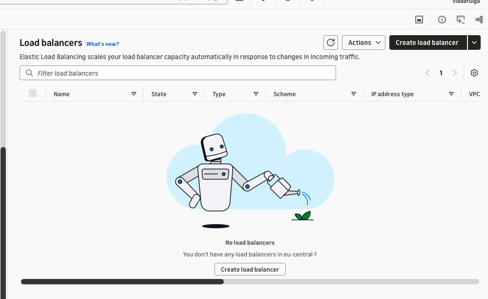

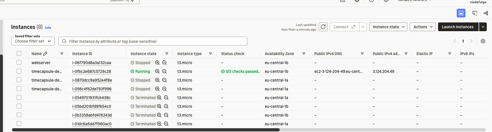

---

## Вывод

В работе создан Application Load Balancer, шаблон запуска и группа Auto Scaling с политикой target tracking. Под нагрузкой группа автоматически увеличила число серверов и после её окончания вернулась к двум. Серверы принимают HTTP только от балансировщика, а SSH только с bastion. Все ресурсы после работы удалены, чтобы не платить за балансировщик.
